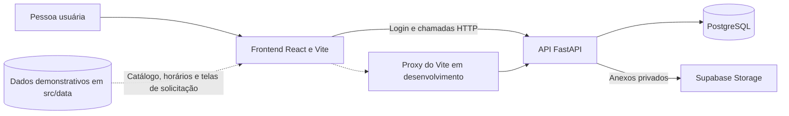

# Arquitetura e integração

O sistema é composto por dois repositórios independentes. O frontend React
apresenta a interface e o backend FastAPI é responsável pelas regras de
negócio e persistência. O navegador acessa a API por HTTP; em desenvolvimento,
o servidor Vite encaminha os caminhos da API para o backend local.

As linhas pontilhadas representam os dados demonstrativos no frontend e o
proxy restrito ao desenvolvimento; não indicam persistência ou proxy em
produção.

## Responsabilidades

| Componente | Responsabilidade | Estado observado |
| --- | --- | --- |
| Frontend React/Vite | Rotas, telas de acesso, componentes e comunicação HTTP. | Login e sessão têm integração com a API; algumas telas de laboratórios e agendamentos usam dados demonstrativos. |
| Backend FastAPI | Autenticação, validação, autorização e regras dos módulos de usuários, espaços, projetos e agendamento. | Mantém solicitações e reservas oficiais no banco. |
| PostgreSQL | Persistência relacional dos usuários, espaços, solicitações, horários e reservas. | O backend cria tabelas ausentes na inicialização; alterações de schema existentes exigem migração apropriada. |
| Supabase Storage | Armazenamento privado de anexos de solicitações. | A API emite links temporários autorizados; a chave de serviço fica somente no ambiente do backend. |

## Módulos do backend

Os módulos de negócio ficam em `app/modulos/`: `usuarios`, `espacos`,
`projetos` e `agendamento`. Eles organizam casos de uso, domínio, infraestrutura
e interface HTTP. Essa separação orienta o código, mas não deve ser descrita
como uma implementação perfeita de Clean Architecture: há casos de uso que
recebem esquemas da camada HTTP.

Os detalhes de permissões e persistência estão em
[API, dados e estado das funcionalidades](./api-dados.mdx). Para executar o
proxy e as duas aplicações, siga [Execução local](./execucao-local.mdx).
Consulte também o [fluxo de uso](../guia-do-usuario/fluxo-de-agendamento.mdx).
