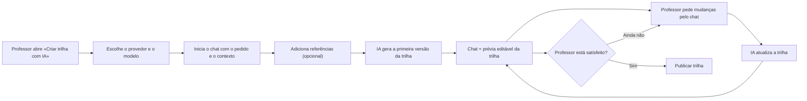

import Tabs from '@theme/Tabs';
import TabItem from '@theme/TabItem';

# Instalação

<Tabs groupId="sistema-operacional">
  <TabItem value="windows" label="Windows" default>

```powershell
winget install Biblioteca.App
```

  </TabItem>
  <TabItem value="linux" label="Linux (Ubuntu)">

```bash
sudo apt install biblioteca-app
```

  </TabItem>
</Tabs>


## Diagrama de fluxo



